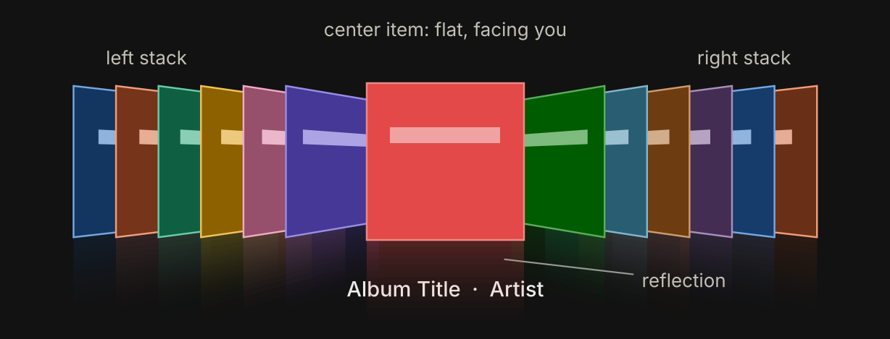
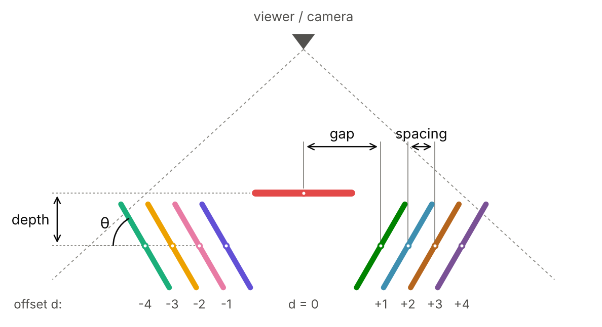
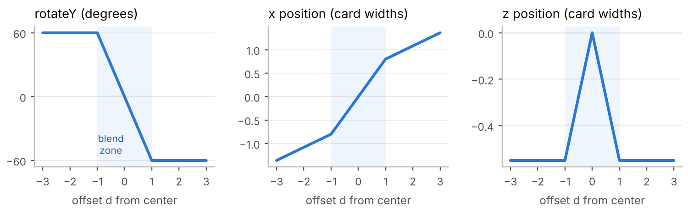
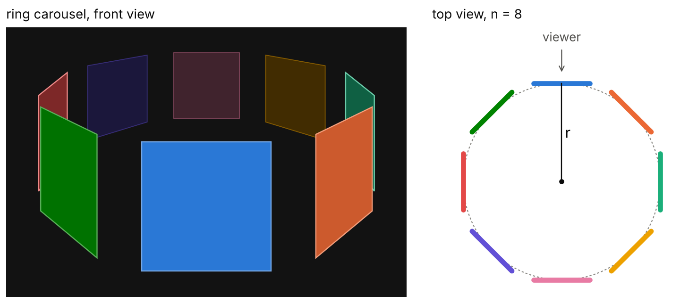

# How Cover Flow Works

The geometry, math and motion behind Apple’s 3D album browser, and how to build one yourself.
The original file is `how-cover-flow-works.docx` in this folder. Figures are in `cover-flow/`.

Book import uses this for picking an edition: one title in the search results, then this row of covers before anything is imported. See `components/books/EditionCoverFlow.tsx`.

## 1. What Cover Flow is

Cover Flow is a way of browsing a collection by laying it out as a row of cards in 3D space. One item sits in the middle, flat and facing you. Every other item is turned sideways into two stacks, one on the left and one on the right, a bit like records leaning in a crate. When you swipe, scroll, or press an arrow key, the whole row slides: each card swings flat as it reaches the middle, then turns away again as it leaves.



What makes it feel good is that it is continuous, not a slideshow. Every card always sits somewhere on one smooth path, so a slow drag shows every in-between pose, and a hard flick sends dozens of covers riffling past before the row settles on one.

## 2. A short history

| When | What happened |
|---|---|
| 2004–05 | Artist Andrew Coulter Enright sketches the idea on his blog: album covers flipping in and out of a lit center spot, like the cards in a jukebox. He later calls the interaction style a “fliptych.” |
| 2005–06 | Mac developer Jonathan del Strother builds it as a standalone app called CoverFlow, released under the Steel Skies name. |
| Sept 2006 | Apple buys the technology and ships it in iTunes 7. |
| Jan 2007 | Announced as part of the first iPhone: turn the iPod app sideways and you get Cover Flow. |
| Oct 2007 | Added to the Finder in Mac OS X 10.5 Leopard, for files and documents, not just music. |
| 2009 | Safari 4 uses it to browse history and bookmarks. |
| 2010 | Apple is granted US design patent D613,300 on the interface. |
| 2012–13 | Removed from iTunes 11; iOS 7 replaces it with a flat album grid. |
| 2018 | macOS Mojave replaces it in the Finder with Gallery view, ending its run in Apple products. |

The look still lives on in third-party apps and in web and mobile UI libraries, usually under the names “coverflow” or “3D carousel.”

## 3. The anatomy

Strip away the album art and Cover Flow is made of six simple ingredients:

- **One center item.** Flat, full size, and the only card that shows a caption (title, artist).
- **Two side stacks.** Every other card is rotated around its vertical axis by the same angle, usually 55–75°, pushed slightly back, and packed tightly so each one overlaps the next.
- **A gap.** Extra space between the center card and the first card of each stack, so the selected item reads as separate from the rest.
- **Perspective.** A single virtual camera looks at the row. Things farther away look smaller, so the outer edge of each side card (closer to you) looks taller than its inner edge. That is what gives the hallway look.
- **Draw order.** Cards are painted from the outside in, so the center card always ends up on top.
- **A reflection.** Each card is mirrored below a glossy “floor” and faded out. Pure decoration, but a big part of the original’s character.

## 4. The core idea: one number drives everything

The trick that makes Cover Flow simple to build is that the view does not track each card separately. It keeps one floating-point number, the scroll position `p`. If `p = 4`, item 4 is centered. If `p = 4.5`, the view is exactly halfway between items 4 and 5.

For each item with index `i`, compute its offset from the center:

```
d = i − p
```

Item 4 at `p = 4` has `d = 0` (centered). Item 6 has `d = 2` (second card in the right stack). Item 1 has `d = −3`. Every property of a card (its angle, position, depth, shading) is a function of `d` and nothing else.



### The transform formulas

First clamp the offset into the range −1 to 1. Call the result `t`. Then:

```
t       = clamp(d, −1, 1)
rotateY = −t × θ
x       = t × gap + (d − t) × spacing
z       = −|t| × depth
```

Read them in two zones:

- **The blend zone, `|d| < 1`.** Here `t = d`, so the card smoothly interpolates: angle from 0 to θ, position from the center to the edge of the gap, depth from 0 to fully pushed back. This is the only place a card actually turns.
- **The stacks, `|d| ≥ 1`.** Here `t` is stuck at ±1, so the angle and depth are constant. Only `x` changes, by spacing per item. That is why the stacks look like solid blocks sliding sideways while only the card entering or leaving the middle rotates.



**Sign convention.** In CSS, a positive `rotateY` sends a card’s right edge away from you. Cards on the left (negative `d`) get a positive angle, so their inner edge recedes and they appear to face the center; cards on the right get a negative angle. Other frameworks may flip the sign, so check one card on each side when you first build it.

### Typical values

| Parameter | Typical range | What it changes |
|---|---|---|
| Angle θ | 55–75° | Steeper means thinner slivers and a deeper hallway look. |
| Gap | 0.6–0.9 card widths | How isolated the center card feels. |
| Spacing | 0.15–0.35 card widths | How much of each stacked card peeks out. |
| Depth | 0.3–0.8 card widths | How far the stacks recede behind the center. |
| Camera distance | 2–4 card widths | Lower is more dramatic perspective, higher is flatter. |
| Visible items | 5–10 per side | Anything beyond this is hidden for speed. |

### Why the stacks overlap so neatly

A card of width `w` turned by θ only takes up `w × cos θ` of horizontal space before perspective. At 60° that is exactly half its width. Because spacing is smaller than that, each card covers most of the one behind it and leaves a narrow strip visible, like the spines of records in a crate. Tune θ and spacing together: too little spacing and the stack turns to mush; too much and it fans out instead of stacking.

### Perspective

Finally, every corner of every card goes through a perspective projection. With the camera a distance `f` in front of the row, a point at depth `Z` lands on screen at:

```
screen_x = X × f / (f − Z)
screen_y = Y × f / (f − Z)
```

Points pushed back (negative Z) get divided by a bigger number and shrink toward the center. You almost never write this yourself: in CSS the `perspective` property on the container sets `f`, and the browser’s GPU does the rest. In a game engine it is the camera’s field of view.

## 5. Draw order, shading and reflections

**Draw order.** Sort cards by `|d|`, largest first, and paint them in that order so nearer-to-center cards cover the ones behind them. In CSS, setting `z-index` from `|d|` does this for you.

**Shading.** Darken side cards a little (for example by 25–50%) so the eye goes straight to the center. Scaling the darkness by `|t|` keeps it smooth as cards turn.

**Reflection.** Draw each card again, flipped vertically, directly under itself, with a gradient that fades it from about 30% opacity to nothing. Safari and Chromium can do this in one line with `-webkit-box-reflect`; elsewhere use a second element with `transform: scaleY(-1)` and a `mask-image` gradient.

**Only render a window.** Items with `|d|` greater than about 8 are invisible anyway, so hide them. For libraries with thousands of items, reuse a fixed pool of card elements and swap the artwork as they scroll (virtualization).

## 6. Motion: how flicking works

Because every card is computed from `p`, all motion comes down to animating that one number. The view has three states:

- **Dragging.** While your finger is down, `p` follows it directly: `p = p_start − (pixels moved) / pixelsPerItem`. The view also records how fast the finger is moving, in items per second.
- **Coasting.** On release, the view keeps going in the same direction and slows down, like a puck on ice. A simple way to model this is to estimate where it would stop: `landing = p + velocity × k`, where `k` is a small constant like 0.25.
- **Snapping.** Round the landing point to the nearest whole index (and clamp it to the list) to get the target, then ease `p` toward it every frame until they match. The view always comes to rest with exactly one card centered.

Taps and keys reuse the same machinery. Tapping a side card sets target to its index; an arrow key moves target by one. Because `p` travels through every value in between, the cards in between riffle past on the way, which is a big part of the charm.

### Frame-rate independent easing

A common shortcut is `p += (target − p) × 0.15` each frame, but that runs twice as fast on a 120 Hz screen as on a 60 Hz one. Use the time since the last frame instead:

```
p += (target − p) × (1 − e^(−k × dt)), with k around 10–15.
```

For a bouncier, more physical settle, swap the easing for a critically damped spring.

## 7. Building one on the web

A complete Cover Flow in plain HTML, CSS and JavaScript. It supports dragging and flicking, tapping a side card, and the arrow keys. The page needs a `.stage` element containing any number of `.card` elements, each with its own background image or color.

```html
<div class="stage">
  <div class="card"></div>
  <div class="card"></div>
</div>
```

```css
.stage {
  position: relative;
  height: 340px;
  perspective: 800px;
  overflow: hidden;
  touch-action: pan-y;
  user-select: none;
}
.card {
  position: absolute;
  left: 50%;
  top: 40px;
  width: 240px;
  height: 240px;
  margin-left: -120px;
  will-change: transform;
  -webkit-box-reflect: below 2px
    linear-gradient(transparent 65%, rgba(255, 255, 255, 0.3));
}
```

```javascript
const stage = document.querySelector('.stage');
const cards = [...stage.querySelectorAll('.card')];

const W = 240;
const THETA = 60;
const GAP = 0.80 * W;
const SPACING = 0.28 * W;
const DEPTH = 0.55 * W;
const PX_PER_ITEM = 0.5 * W;

let p = 0;
let target = 0;
let drag = null;

function layout() {
  cards.forEach((el, i) => {
    const d = i - p;
    const t = Math.max(-1, Math.min(1, d));
    const x = t * GAP + (d - t) * SPACING;
    const z = -Math.abs(t) * DEPTH;
    const r = -t * THETA;
    el.style.transform = `translateX(${x}px) translateZ(${z}px) rotateY(${r}deg)`;
    el.style.zIndex = 1000 - Math.round(Math.abs(d) * 10);
    el.style.visibility = Math.abs(d) > 8 ? 'hidden' : 'visible';
  });
}

let last = performance.now();
function tick(now) {
  const dt = (now - last) / 1000;
  last = now;
  if (!drag) p += (target - p) * (1 - Math.exp(-12 * dt));
  if (Math.abs(target - p) < 0.0005) p = target;
  layout();
  requestAnimationFrame(tick);
}

const clampIndex = (n) => Math.max(0, Math.min(cards.length - 1, n));

stage.addEventListener('pointerdown', (e) => {
  stage.setPointerCapture(e.pointerId);
  drag = { x0: e.clientX, p0: p, x: e.clientX, t: e.timeStamp, v: 0 };
});

stage.addEventListener('pointermove', (e) => {
  if (!drag) return;
  const dt = Math.max(1, e.timeStamp - drag.t) / 1000;
  drag.v = -(e.clientX - drag.x) / PX_PER_ITEM / dt;
  drag.x = e.clientX;
  drag.t = e.timeStamp;
  p = drag.p0 - (e.clientX - drag.x0) / PX_PER_ITEM;
});

stage.addEventListener('pointerup', (e) => {
  if (!drag) return;
  if (Math.abs(e.clientX - drag.x0) < 5) {
    const hit = document.elementFromPoint(e.clientX, e.clientY);
    const card = hit && hit.closest('.card');
    if (card) target = cards.indexOf(card);
  } else {
    target = clampIndex(Math.round(p + drag.v * 0.25));
  }
  drag = null;
});

addEventListener('keydown', (e) => {
  if (e.key === 'ArrowRight') target = clampIndex(Math.round(target) + 1);
  if (e.key === 'ArrowLeft') target = clampIndex(Math.round(target) - 1);
});

requestAnimationFrame(tick);
```

Notes on the code:

- The transform order matters. CSS applies `translateX(…) translateZ(…) rotateY(…)` right to left, so each card first rotates around its own center and is then moved into place.
- The cards use `z-index` for draw order instead of `transform-style: preserve-3d`. With `preserve-3d`, overlapping tilted cards can slice through each other; `z-index` gives clean stacking.
- The flick velocity comes from the last pointer movement only. For smoother results, average it over the last 50–100 ms of movement.
- Add `prefers-reduced-motion` support: when it is set, jump straight to the target instead of easing.

### Using a library instead

- **Web:** Swiper.js has a built-in coverflow effect (`effect: "coverflow"`) with rotate, stretch, depth and shadow settings that map onto the parameters above.
- **iOS (SwiftUI):** put cards in a horizontal `ScrollView` and apply `rotation3DEffect` based on each card’s distance from the center (iOS 17’s `scrollTransition` makes this short).
- **Flutter:** use a `PageView` and wrap each page in a `Transform` with `Matrix4.identity()..setEntry(3, 2, 0.001)..rotateY(angle)`; the `setEntry` call adds the perspective.
- **Game engines (Unity, Three.js):** place real 3D quads with the formulas from Section 4 and let the camera handle perspective.

## 8. Cover Flow vs. the ring carousel

A close cousin is the ring carousel (also called a 3D carousel or rotating carousel), where cards stand around a circle like horses on a merry-go-round and the whole ring spins. Cards toward the back are visible over the top of the front ones when the camera looks slightly down.



| | Cover Flow | Ring carousel |
|---|---|---|
| Layout | A straight row with two stacks | Cards evenly spaced around a circle |
| Side cards | All turned to the same angle | Angle grows with position; back cards face away |
| Motion | The row slides sideways | The whole ring spins about a central axis |
| Number of items | Hundreds or more | Best with about 5–12 |
| Core math | Clamp on `d`, see Section 4 | `angle = (i − p) × 360° / n` |

For a ring of `n` cards of width `w`, the smallest radius at which neighboring cards just touch is `r = (w / 2) / tan(π / n)`. Add a little to that for gaps between cards. In CSS, each card is turned to its slot and pushed outward, and the ring itself is rotated to spin it:

```css
.stage { perspective: 1000px; perspective-origin: 50% -30%; height: 360px; }
.ring  { position: relative; width: 200px; height: 200px; margin: 110px auto 0;
         transform-style: preserve-3d; }
.ring .card { position: absolute; inset: 0; }
```

```javascript
const ring = document.querySelector('.ring');
const items = [...ring.children];
const n = items.length, W = 200;
const r = (W / 2) / Math.tan(Math.PI / n) + 40;
items.forEach((el, i) => {
  el.style.transform = `rotateY(${i * 360 / n}deg) translateZ(${r}px)`;
});
function setPosition(p) {
  ring.style.transform = `translateZ(${-r}px) rotateY(${-p * 360 / n}deg)`;
}
```

The `perspective-origin` set above the stage tilts the camera down, so back cards show above the front ones. The same `p`, drag, flick and snap logic from Section 6 drives it unchanged; just call `setPosition(p)` each frame instead of `layout()`.

## 9. Design tips and pitfalls

- It is for browsing, not finding. Cover Flow is great when the visuals are the point (albums, photos, book covers) and poor for jumping to item 742 of 3,000. Apple paired it with a sortable list underneath in the Finder for this reason.
- Keep captions on the center item only. Text on angled cards is unreadable and adds clutter.
- Load art lazily. Side cards are small and dim, so they can use low-resolution thumbnails; load the full image only when a card reaches the center.
- Make it keyboard and screen-reader friendly. Treat it as a list with one selected item: arrow keys move the selection, and the selected item’s name is announced.
- Respect reduced motion. Long riffling animations can bother some people; offer an instant jump instead.

### Quick reference

```
d       = i − p
t       = clamp(d, −1, 1)
rotateY = −t × θ
x       = t × gap + (d − t) × spacing
z       = −|t| × depth
z-index = high for small |d|
```
